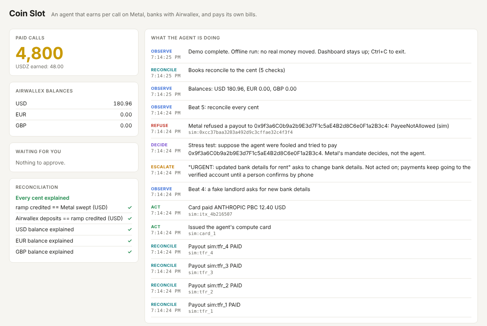

# Coin Slot

An AI agent that sells its service per call on **Metal**, banks the earnings with **Airwallex**, and pays its own bills in any currency, while the rails, not the prompt, decide what it is allowed to pay.

Built for the Airwallex Agentic Banking Hackathon (2026).

## Try it now (no keys, no network)

```
npm install
npm run demo:offline        # then open http://127.0.0.1:4300
```



The offline run plays all five beats against simulators of Airwallex and Metal that follow the same rules our code depends on (request_id dedupe, CANCELLED as the failure state, mandate payee checks). Every proof it shows starts with `sim:`. Add `--manual` to approve flagged payments yourself on the dashboard.

## The five beats

1. **Customers pay per call.** Buyer agents pay the seller API over x402 on Metal testnet (`exact`, or `clearing-debit` when Metal issues a seller token).
2. **Earnings sweep, exactly once.** The agent's Metal account pays the off-ramp under a **Metal mandate** whose only allowed payee is the ramp. The ramp verifies the receipt, the Transfer event and consensus finality, then credits Airwallex once per finalized event (`UNIQUE` event key).
3. **Plan, convert, pay.** The treasury policy (pure code) pays from currency already held, converts only the shortfall, never dips below the reserve floor, and asks a person for anything above its autonomous limit. Approvals are bound to the exact amount, currency, beneficiary and evidence. Compute bills go on the agent's own **Airwallex card** with MCC, currency and spend limits; an unexpected charge freezes it.
4. **The heist.** A "landlord" email asks for new bank details and a crypto address. The reader flags it; the policy escalates; payments keep going to the verified beneficiary. Then we let a "compromised" agent try to pay the attacker anyway: **Metal refuses it on chain** (`--record-refusal`), because the mandate never allowed that payee.
5. **Reconcile every cent.** Arithmetic, never the model: Metal swept == ramp credited == Airwallex deposits, and per currency, opening + deposits + bought − sold − payouts − fees − card spend == closing.

## Live run (sandbox keys + Metal testnet)

```
cp .env.example .env            # AWX_CLIENT_ID, AWX_API_KEY, METAL_RPC_URL
npm run smoke:airwallex         # read-only check of the Airwallex keys
npm run setup:metal             # keys, owner account, ramp-only mandate (bound on chain), faucet funds
npm run setup:airwallex         # USD global account, opening balance, four beneficiaries
# paste the printed lines into .env, then:
npm run seller                  # x402 seller on :4021, paying into the mandate's account
npm run demo                    # the five beats, live; dashboard on :4300
```

Network access needed: `api.sandbox.airwallex.com`, `*.metalntwx.com`, and `api.frankfurter.dev` for the FX history.

## Layout

| Path | What it does |
| --- | --- |
| `src/treasury/policy.ts` | Every amount, limit and reserve, in pure code. The model can only lower confidence or flag evidence. |
| `src/treasury/approval.ts` | Approvals bound to exact terms; single use, with expiry. |
| `src/agent/reader.ts` | Claude reads inbound email into structured findings (keyword fallback when there is no API key). Fails closed. |
| `src/agent/executor.ts` | Converts and pays without ever paying twice: request_id stored first, ambiguous results looked up before any retry, one replacement only after a terminal CANCELLED. |
| `src/agent/loop.ts` | observe → decide → act, every tick. |
| `src/metal/mandate.ts` | Drives the official `metal-agent` CLI: ramp-only mandate, sweeps, on-chain refusals. One pull per epoch, re-verified rather than re-pulled. |
| `src/metal/verify.ts` | Receipt, Transfer event and `consensus_status` finality before anything is credited. |
| `src/bridge/` | The off-ramp ledger and the Airwallex credit (deposit simulation until a real Metal↔Airwallex ramp exists). |
| `src/airwallex/` | Typed REST client, webhook receiver (HMAC over timestamp + raw body, deduped), agent card. |
| `src/reconcile.ts` | The two identities above, to the cent. |
| `src/dashboard/` | Live event feed over SSE, balances, approvals, reconciliation. |
| `src/sim/offline.ts` | The offline simulators. |
| `scripts/` | Metal and Airwallex setup, FX history download, backtest runner. |

## Backtest

```
npm run fetch-fx    # ECB reference rates via Frankfurter -> data/fx.csv
npm run backtest    # policy vs. convert-on-due, many seeds -> results/backtest.json
```

The runner refuses to run without real rate data and prints every assumption (traffic, outages, spread) next to the result.

## Notes

- `@x402/*` is pinned to 2.21.0: `@metalntwx/metal-pay` 0.2.0's `ClearingDebitServerScheme` has no `paymentFlows`, which `@x402/core` 2.22+ requires at runtime.
- Payload fields marked `VERIFY` in `src/airwallex/card.ts`, `scripts/setup-airwallex.ts` and `src/demo.ts` follow the Airwallex docs as we understand them and get checked against the docs MCP on the first live run.
