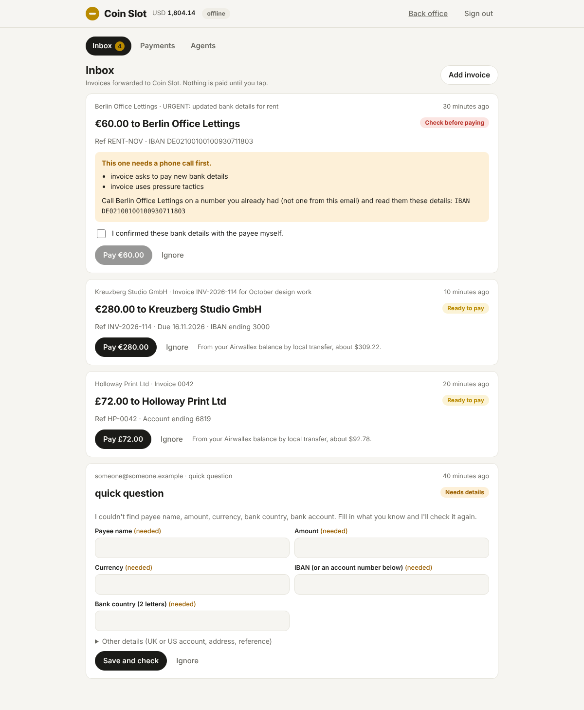

# Coin Slot

**Any AI agent can pay any real-world invoice.** An agent holding USDZ on **Metal** asks Coin Slot to pay "€480 to this IBAN", pays the quoted price over x402, and Coin Slot delivers the money in local currency through **Airwallex**. Businesses get the same thing without writing code: forward an invoice to Coin Slot's inbox, tap once, and it's paid.

The rails decide what is allowed, not the prompt:
- **Fiat moves only after the agent's payment settles on Metal.** An unsettled or failed payment releases the quote, and nothing is paid.
- **Every quote is single-use.** Each payout id doubles as Airwallex's `request_id`, so nothing is paid twice.
- **Airwallex validates the payee before anyone pays.**
- **The risk rules are code.** They cover blocked countries, caps, velocity and large first payouts. An invoice that asks to pay new bank details is held until a person confirms with the payee.
- **A bounced payout is refunded in full** under a Metal **refund mandate**. Metal caps each refund and the lifetime total.
- **Earnings reach the Airwallex float only through a Metal sweep mandate whose only payee is the ramp.** A compromised agent trying to drain them is refused on chain.
- **Reconciliation is arithmetic, to the cent.**

Built for the Airwallex Agentic Banking Hackathon (2026). Demo script: [docs/DEMO-SCRIPT.md](docs/DEMO-SCRIPT.md). Write-up: [docs/SUBMISSION.md](docs/SUBMISSION.md).



## Try it now (no keys, no network)

```
npm install
npm run demo:offline     # three agents pay over MCP, the inbox, a refund, the heist, reconciliation
npm run serve:offline    # or open the app on :4021 and sign in with coinslot-demo
npm run test:e2e         # the app's flows in a real browser
```

Offline mode swaps Airwallex and Metal for simulators. They follow the rules our code depends on: `request_id` dedupe, `CANCELLED` as the failure state, and the mandate's payee checks. Every proof they produce starts with `sim:`.

## Use it from an agent (MCP)

```
claude mcp add coinslot -e COINSLOT_URL=http://127.0.0.1:4021 -e COINSLOT_BUYER_KEY=0x... -- npx tsx src/mcp/server.ts
```

| Tool | What it does |
| --- | --- |
| `quote_payout` | Prices a payout, for free. |
| `pay_invoice` | Quotes, then pays only if the price is at most `max_usdz`. |
| `pay_quote` | Pays an existing quote by id. |
| `payout_status` | Reports where a payout is. |

Metal itself refuses to sign above `COINSLOT_MAX_USDZ`.

## API

| Call | Price | What it does |
| --- | --- | --- |
| `POST /v1/quotes` | free | Price, payee check, risk. Returns a quote, `needs_review` or `rejected`, with reasons. |
| `POST /v1/payouts/:id/pay` | x402: the quote total | Locks the quote. The payout runs once the payment settles. |
| `GET /v1/payouts/:id` | free | Status, Airwallex transfer id, refund tx. Never returns bank details. |
| `POST /v1/inbox` | owner, or `x-inbox-secret` | Forward an invoice email (`from`, `subject`, `body`). |
| `POST /v1/inbox/:id/approve` | owner | The one tap. `verified_with_payee: true` is needed for held invoices. |
| `POST /v1/inbox/:id/details` | owner | Fill in what the extractor couldn't find; the invoice is checked again. |
| `GET /v1/payouts`, `POST /v1/payouts/:id/review` | owner | Every payout; allow or block a held agent payout. |

"Owner" means the app's session cookie (sign in with `OWNER_TOKEN`) or `Authorization: Bearer <OWNER_TOKEN>`. Agents never need it.

## The app

`/` is the app: an inbox of forwarded invoices with one-tap pay, a phone-call check for invoices that change bank details, a form for missing details, every payment with its progress, and how to connect an agent. `/ops/` is the live back office feed. Both sit behind the owner's sign-in, and the page renders invoice text as text under a strict CSP.

## Live run (sandbox keys and Metal testnet)

```
cp .env.example .env            # AWX_CLIENT_ID, AWX_API_KEY, METAL_RPC_URL
npm run smoke:airwallex         # read-only check of the Airwallex keys
npm run setup:metal             # keys, owner account, sweep and refund mandates bound on chain, faucet funds
npm run setup:airwallex         # USD global account and opening float
# paste the printed lines into .env, then:
npm run demo                    # or: npm run serve
```

Network access needed: `api.sandbox.airwallex.com`, `*.metalntwx.com`, and optionally `api.frankfurter.dev` for the FX history.

## Layout

| Path | What it does |
| --- | --- |
| `src/payouts/` | The product: pricing, risk, the payout book (compare-and-set states), the service, and the x402 API. |
| `src/inbox/` | Invoice extraction (Claude, or patterns with no key), the one-tap inbox, and IMAP polling. |
| `src/mcp/server.ts` | The MCP tools agents install. |
| `src/metal/` | Mandates through the official `metal-agent` CLI (sweep, refunds, on-chain refusals), finality checks, and on-chain earnings. |
| `src/bridge/` | The off-ramp ledger: one Airwallex credit per finalized Metal event. |
| `src/airwallex/` | Typed REST client, signed and deduped webhooks, and the agent card. |
| `src/reconcile.ts` | Metal swept == ramp credited == Airwallex deposits, and every currency's balance explained. |
| `src/web/` | The app (no build step). `tests/app.e2e.ts` drives it in a browser. |
| `src/auth.ts` | The owner's sign-in. |
| `src/app.ts`, `src/serve.ts`, `src/demo.ts` | The service in one process, and the demo that drives it through MCP and the inbox. |
| `src/treasury/`, `src/agent/` | The treasury policy, bound approvals, the email reader and the executor. |
| `src/sim/offline.ts` | The offline simulators. |

## Notes

- `@x402/*` is pinned to 2.21.0. `@metalntwx/metal-pay` 0.2.0's `ClearingDebitServerScheme` has no `paymentFlows`, which `@x402/core` 2.22+ requires at runtime.
- Payload fields marked `VERIFY` follow the Airwallex docs as we understand them. They get checked against the docs MCP on the first live run.
- The x402 payment path (dynamic price per quote, settle hooks) has not run against Metal's facilitator yet, because this environment can't reach it. Offline, the same routes run with simulated payments.
